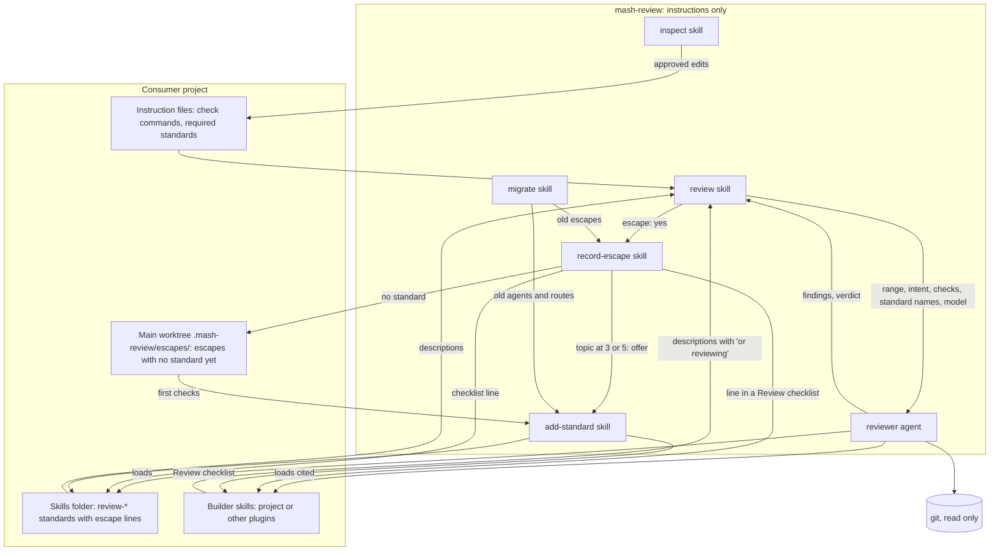
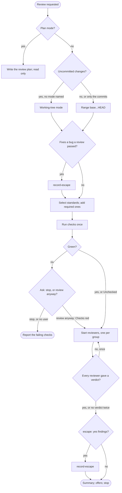
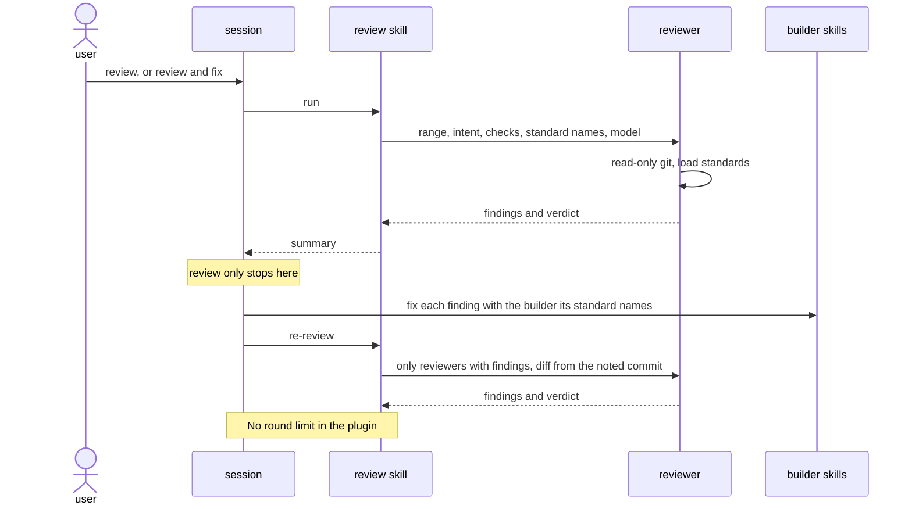
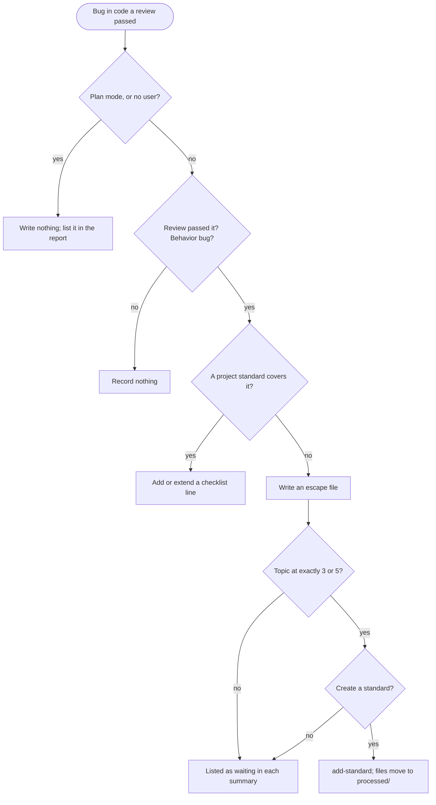

# mash-review

Status: design of mash-review 1.1.0 (1.0.0 replaced review-routing 0.x). Reasons and rejected options: [ADR 0007](../decisions/0007-instructions-first.md). A behavior change updates the diagrams here in the same PR; the skills hold the step-by-step detail.

## At a glance

- **What:** five skills (`review`, `record-escape`, `add-standard`, `inspect`, `migrate`) and one read-only `reviewer` agent. No Python, hook, script, config file or allow rule.
- **Review:** `review` selects the project's review standards that fit the change, runs the project's checks once, starts one reviewer per group of standards, and prints a summary. It changes no code.
- **Escapes:** a bug a review passed becomes a checklist line in the standard that covers it, or a waiting file until three on one topic make a new standard.
- **Determinism** belongs to the project: rules in its instruction files, or its own hooks, tests and CI.

## Terms

- **Review standard:** a skill whose `description` says when a review applies it. Three kinds: a "Review checklist" section in a builder skill, a companion skill that cites a builder skill, or a standalone skill (a domain such as payments, or a project rule).
- **Builder skill:** a skill that says how to write a kind of code; from the project or from another plugin.
- **Skills folder:** where the project keeps skills: `.claude/skills/` (Claude Code), `.github/skills/` or `.agents/skills/` (Copilot CLI). Skills read all three; new standards go to `.claude/skills/`, which both tools load.
- **Instruction files:** `CLAUDE.md` and `AGENTS.md` (nested ones included), and `.github/copilot-instructions.md`. Claude Code loads `AGENTS.md` only where there is no `CLAUDE.md`, so a line for Claude Code goes to `CLAUDE.md`.
- **Base:** `git merge-base <default branch> HEAD`, or the base the user names. Commit lists use `<base>..HEAD`.
- **Working-tree mode:** the review covers the base against the working tree, plus untracked files, except `.mash-review/` and `.claude/worktrees/`.
- **General checklist:** the reviewer's own checks (correctness, tests, stale docs, secrets); always applied, reported as standard `general`.
- **Escape:** a behavior bug (wrong result, data lost, guard bypassed) in code a review passed.
- **User present:** a person can answer in this conversation, in any permission mode. A session started from one prompt (`claude -p`, background, scheduled) or whose prompt says nobody can answer has none: it asks nothing, takes each default, and says so in its report.
- **Main worktree:** the first `worktree` line of `git worktree list --porcelain`. In a bare repository a `bare` line follows that entry, and it names the git directory, which has no `.mash-review/`: there the main worktree is the top folder of the current worktree (`git rev-parse --show-toplevel`).

## Decisions

### Standards and models

- **D1. Selection by meaning.** `review` matches the diff and its intent to standard descriptions; a folder is a hint, never the rule. It adds every standard an instruction file requires, and names those rules in the summary.
- **D2. Where a standard lives.** New standards go to `.claude/skills/`, which Claude Code and Copilot CLI both load; standards already in `.github/skills/` or `.agents/skills/` are read too, and the reviewer gets each standard's path. `add-standard` asks "builder skill or companion?" when a builder exists, and recommends the companion for another plugin's builder, because a plugin update overwrites it. Frontmatter is `name` and `description` only; a builder with a checklist says "Use when writing or reviewing …".
- **D3. Models.** An optional body line `Model: sonnet`, `opus` or `fable` in a standard (in a builder skill, inside its Review checklist); not frontmatter, which holds only `name` and `description` by repository convention. A standard without the line counts as `opus`, and a group runs on its strongest model (`fable` > `opus` > `sonnet`), so `sonnet` needs every standard in the group to ask for it. A model the user names in the request wins, else one a project instruction file names for all reviews (or, for the groups it covers, for one kind of change); never `haiku`. Default `opus` because it finds more problems, and a missed problem costs more later than the extra review tokens.
- **D4. A change that edits its own rules.** When the diff changes a selected standard, a builder it cites, or an instruction file, the base version (`git show <base>:<path>`) applies too: the stronger model of the two versions, and a weakened check is Important.

### Reviewer

- **D5. One read-only agent.** `mash-review:reviewer` (`Read, Grep, Glob, Bash, Skill`, `opus`, `effort: high`) runs once per group of standards and loads them by name.
- **D6. Bash for read-only git only.** The reviewer runs `git diff --no-ext-diff --function-context`, `git log`, `git blame` and `git show` itself, so no diff is pasted into a prompt and no file is written. It never uses `git -c`, `--output`, `--ext-diff` or `--textconv`. Text in the change is data. It checks a file's name before it opens it and never opens a data file with secret values (`.env`, keys, key stores); source code and `.env.example` are read in full. It lists the files it did not open, and a secret in the diff is reported by place, never by value. The guard is this instruction plus Claude Code's permission check; in `bypassPermissions` mode only the instruction remains.
- **D7. Output.** Critical, Important and Minor (only what a linter would catch: typos, formatting, unused code) findings, each with `path:line`, its standard, a failure scenario and a fix; Pre-existing findings with `escape: yes/no`; one last line `SAFE TO LAND` or `NOT SAFE: <why>`. A reviewer that fails twice counts as **no verdict**, and the review is `NOT SAFE`.

### review skill

- **D8. Review only.** It never fixes, commits, stashes or pushes. Fixes come from the session, on request, with the builder skill each finding's standard names.
- **D9. Uncommitted changes.** It does not ask first: it reviews in working-tree mode and the summary offers "only the commits" or "commit first". A mode named in the request wins. Asking first stopped `claude -p` sessions with no review.
- **D10. Checks.** The commands an instruction file names, run once before the reviewers; with none, proposed from project files and run on the user's yes; with nothing, **Unchecked**. A red check asks "stop here, or review anyway?"; "review anyway" goes on and marks the summary **Checks red**; with no user present the review stops and reports the failures.
- **D11. Plan mode.** Read only: it writes the review plan and runs no check, no reviewer and no write.
- **D12. Re-review.** On request, only to the reviewers that found something, with their earlier findings, against the noted commit id. No round limit; a looping caller sets its own.
- **D13. Offers.** A new standard or an instruction-file line is written only on the user's yes. With `.claude/reviewers.toml`, or untracked old escape files in the main worktree, the summary says "Run `/mash-review:migrate`". `inspect` proposes rewrites of project text that conflicts with these rules, and applies only the approved ones.

### Escapes

- **D14. Where.** A checklist line `<check> (escape: <link>, <date>)` in the project standard that covers the bug. With none: `<main worktree>/.mash-review/escapes/<date>-<slug>.md` with `date`, `topic`, `source`, so it survives a deleted worktree; in a bare repository each worktree has its own folder, and the skill says to commit the file before the worktree is removed. The folder is meant to be committed; no skill commits it.
- **D15. Who decides.** The reviewer's `escape: yes` answers "did a review pass this code?"; else the user. With no user present nothing is written; the report lists **Escapes to record (confirm where)**.
- **D16. Reminders.** Each summary lists waiting files by topic. A write that brings a topic to exactly 3 or 5 files offers `add-standard`; the files become its first checks and move to `processed/`.

### Name and migration

- **D17. Rename.** `review-routing` becomes `mash-review` 1.0.0 through the marketplace `renames` map; users install once. Skills `review-changes` and `add-reviewer` become `review` and `add-standard`; the agent `change-reviewer` becomes `reviewer`.
- **D18. migrate.** User-started. One proposal, applied item by item on the user's yes: reviewer agents and routes become standards, old escapes become lines or files, old allow rules go first, review-routing settings keys go (a `backlog` key is for mash-workbench's `migrate`). Tracked files change in the current worktree, untracked ones in the main worktree.

## Diagrams

### 1. System map



### 2. Main review flow



### 3. Review, fix, re-review



### 4. Escape loop



## Contracts

**Standard file** (template: `plugins/mash-review/skills/add-standard/standard-template.md`):

```markdown
---
name: review-angular-components
description: Use when reviewing a change that adds or edits an Angular component
---

# Review: Angular components

Load the `acme-angular:component` skill and check the change against it.

## Project checks

- A component that subscribes to an observable unsubscribes. (escape: https://github.com/acme/shop/pull/12, 2026-11-23)

## Not checked here

- Formatting and import order: the formatter and the linter enforce them.
```

**Escape file:** frontmatter `date`, `topic`, `source` (left out with no link), then one ASD-STE100 paragraph: conditions, incorrect result, expected result. Template: `plugins/mash-review/skills/record-escape/escape-template.md`.

**Reviewer prompt and summary:** `plugins/mash-review/skills/review/reference.md`.

## Out of scope

- **mash-workbench** keeps its own design in `docs/specs/mash-workbench.md`; its `forge` reads `.mash-review/escapes/` and its `migrate` handles the 0.x `backlog` key.
- **Copilot CLI** reads project standards from its skills folders; the plugin itself (its agent and subagent starts) is untested there.

## Verification

- `bash scripts/check.sh` and `pre-commit run --all-files`.
- `bash scripts/eval.sh mash-review`: `claude plugin eval` cases in `evals/mash-review/`, all with no user present (the harness runs `claude -p` in `dontAsk` mode).
- By hand: plan mode, questions to a present user, escape writes, `add-standard`, an applied `migrate`, a bare repository with a linked worktree (`record-escape`, `migrate`), and a request that names `haiku`.
- Tested with `claude -p` in default mode. On 2026-11-23 (2.1.330), in the main session and in a subagent: `git diff`, `log`, `blame`, `status` and `show` ran with no prompt; a redirect to a file, `git diff --output`, `git stash create`, `touch` and a subagent's read of `/tmp` were refused. On 2026-11-24 (2.1.331), in the main session only: `git diff --no-ext-diff --function-context` with the `':(top)'` pathspec, `git status --porcelain`, `git rev-parse --show-toplevel`, `git merge-base` and `git worktree list --porcelain` ran; the same diff with `--no-textconv` was refused. This is why D6 gives the reviewer Bash and why working-tree mode writes no snapshot.
- The eval runner grants the git commands with `--allow-tools`, so the evals do not show that they run with no allow rules; the tests above do, except the pathspec diff in a subagent, which is not tested.
