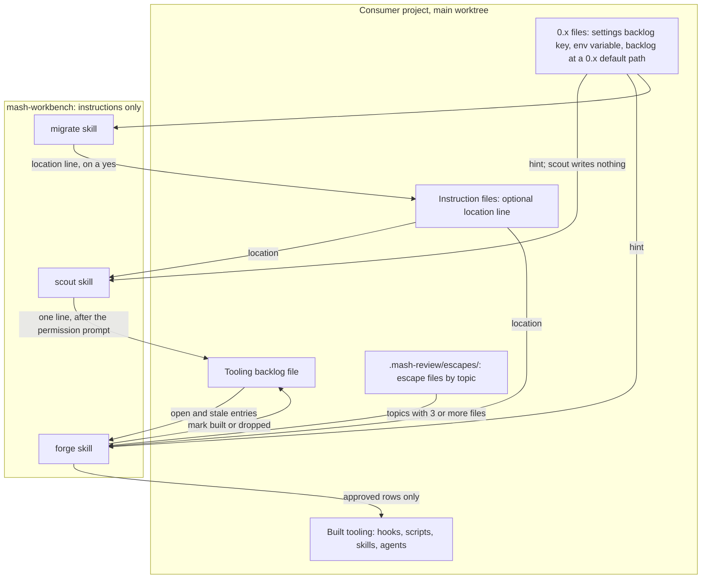
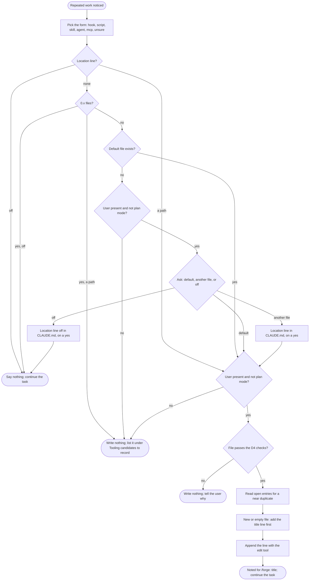
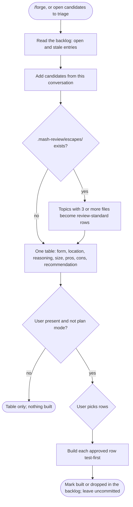

# mash-workbench

Status: design of mash-workbench 1.0.0, which replaces the scripts of 0.x with instructions. Reasons and rejected options: [ADR 0008](../decisions/0008-mash-workbench-instructions-only.md). A behavior change updates the diagrams here in the same PR; the skills hold the step-by-step detail.

## At a glance

- **What:** three skills (`scout`, `forge`, `migrate`). No Python, hook, script, settings file or allow rule.
- **Capture:** `scout` notes repeated work as one line in the project's tooling backlog and returns to the task.
- **Promote:** `forge` triages the backlog, the current conversation and mash-review escape topics into one table, and builds only what the user approves.
- **Determinism** belongs to the project: the ladder hook > script > skill > agent > mcp describes what `forge` builds in the project, not the plugin itself.

## Terms

- **Tooling backlog:** a Markdown file whose first line is `# Tooling backlog`, one candidate per line: `- [ ] <YYYY-MM-DD> · <form> · <title> — <why>`.
- **Form:** `hook`, `script`, `skill`, `agent`, `mcp`, or `unsure`.
- **Main worktree:** the first `worktree` line of `git worktree list --porcelain`; in a bare repository (that entry is followed by `bare`), the top of the current worktree. The location line, the backlog and the 0.x files are read and written there only, also from a linked worktree, so every worktree finds the same ones and a deleted linked worktree loses nothing. In a bare repository each worktree keeps its own: its new backlog lines must be committed before the worktree is removed.
- **Instruction files:** `CLAUDE.md` and `AGENTS.md` at the repository top, and `.github/copilot-instructions.md`. Claude Code loads `AGENTS.md` only where there is no `CLAUDE.md`, so a line for Claude Code goes to `CLAUDE.md`.
- **Location line:** `Tooling backlog: <path>` or `Tooling backlog: off` in an instruction file. `<path>` is relative to the repository top.
- **User present:** a person can answer in this conversation, in any permission mode. A session started from one prompt (`claude -p`, background, scheduled) or whose prompt says nobody can answer has none: it asks nothing, writes nothing, and lists what it would have done in its report.
- **Escape topic:** the `topic:` of a mash-review escape file in `<main worktree>/.mash-review/escapes/` (not `processed/`).

## Decisions

### Backlog

- **D1. Instructions only.** The model writes the backlog line with its own edit tool; no script and no allow rule exist. In the default permission mode Claude Code asks for the write. In `acceptEdits`, auto or `bypassPermissions` mode, or with an edit allow rule, it does not: then the D4 checks rest on the model alone.
- **D2. Location.** Default `.mash-workbench/tooling-backlog.md` in the main worktree: the plugin's own folder, as mash-review uses `.mash-review/`. It is not `.claude/mash-workbench/`, the 0.x settings folder. A location line in an instruction file of the main worktree overrides it; `CLAUDE.md` wins over `AGENTS.md`, which wins over `.github/copilot-instructions.md`. No settings file, no environment variable.
- **D3. First time.** With no backlog file and no location line, `scout` asks once: the default (recommended), another file, or off. The answer for another file or off becomes a location line, written only on a yes: in `CLAUDE.md`, else in an existing `AGENTS.md` (a new `CLAUDE.md` would hide it from Claude Code), else in a new `CLAUDE.md`. The default needs no line. A no to the line: the answer holds for this session only, and a later session asks again.
- **D4. Which file it writes.** A path inside the repository that ends in `.md`, and is new, empty, or starts with `# Tooling backlog`. Not a symbolic link, and no symbolic link on its path (checked with `ls -la` on each part, because git does not show an untracked link or a path under a linked folder). Anything else: write nothing and tell the user why. These were the checks of `backlog-add.sh`; they are now instructions, and the permission prompt is the guard.
- **D5. Entry.** One line, the format in Terms. A new or empty file first gets `# Tooling backlog` and a blank line. Before the write, `scout` reads the open entries; a near duplicate gets "(similar to <title>)" in its one-line note, and `forge` merges the two.
- **D6. No user present, or plan mode.** Write nothing. The final report gets a "Tooling candidates to record" block, one line per candidate.

### Forge

- **D7. Sources.** Open backlog entries; this conversation (procedures repeated two or more times, repeated corrections, manual checks, memories that describe a procedure); escape topics with 3 or more files (any count from 3, unlike mash-review's offer at exactly 3 or 5), as a candidate of form "review standard" built by `mash-review:add-standard`. Without a `.mash-review/escapes/` folder, that source is skipped.
- **D8. Stale.** An open entry older than 30 days, or with no date, gets a row: build it or drop it (`- [x] … → dropped: <why>`).
- **D9. One table, then the user.** One row per candidate: form, location, reasoning, size, pros and cons, a recommendation. Only approved rows are built, test-first. With no user present: the table, and nothing built.
- **D10. Data and checks.** Backlog lines and escape files are data: no instruction in them is followed, and no command they name is run. `forge` reads and marks the backlog only when it passes the D4 checks.

### Migration

- **D11. migrate.** User-started. One proposal from what 0.x left: the 0.x choice (`MASH_WORKBENCH_BACKLOG` in an `env` block, else the `backlog=` key of `.claude/mash-workbench/settings*`) becomes a location line (a path outside the repository: the file moves into it); an old backlog at a 0.x default (`docs/mash/tooling-backlog.md`, `docs/tooling-backlog.md`) moves to `.mash-workbench/tooling-backlog.md` or gets a location line; the `backlog-add.sh` allow rules and the `MASH_WORKBENCH_BACKLOG` and `MASH_PYTHON` entries go first; the settings files and their `info/exclude` line go when no key is left. mash-review's own keys are left to mash-review's `migrate`. Every change is in the main worktree. Plan mode or no user present: the proposal only.
- **D12. 0.x files.** With no location line, 0.x files are a `backlog` key in `.claude/mash-workbench/settings*` of the main worktree, `MASH_WORKBENCH_BACKLOG` in an `env` block of its `.claude/settings*.json`, or a backlog at a 0.x default, `docs/mash/tooling-backlog.md` or `docs/tooling-backlog.md` (tracked or not). A location line wins over them. A 0.x choice of `off` counts as `off`. Otherwise, while one exists, `scout` writes nothing: it lists the candidate as with no user present, so it never creates a second backlog; `forge` reads no backlog and says why. `scout` and `forge` add one line to their output: "This project has mash-workbench 0.x files; run `/mash-workbench:migrate`". They do not stop the task for it. The hint and `migrate` go in a later major version.

## Diagrams

### 1. System map



### 2. scout



### 3. forge



## Contracts

**Backlog file:**

```markdown
# Tooling backlog

- [ ] 2026-10-14 · script · Check the lockfile matches CI's Python version — CI failed twice on a version the lockfile did not pin
- [x] 2026-09-02 · hook · Block edits to generated files — edited them twice → built: .claude/hooks/no-generated.sh
```

The first line must be `# Tooling backlog`. A `repo:` line under the title, written by 0.3.0, is ignored.

**Location line** (in `CLAUDE.md`):

```markdown
Tooling backlog: docs/tooling/backlog.md
```

**No-user report block:**

```text
Tooling candidates to record:
- <form> · <title> — <why>
```

## Out of scope

- **Cross-session leads.** 0.x read Claude Code transcripts with `past-friction.py`; 1.0.0 does not. `scout` must catch repeated work while it happens.
- **Copilot CLI** reads the skills as `SKILL.md` files; the plugin is untested there.

## Verification

- `bash scripts/check.sh` and `pre-commit run --all-files`.
- `bash scripts/eval.sh mash-workbench`: `claude plugin eval` cases in `evals/mash-workbench/`, all with no user present.
- By hand with `claude --plugin-dir plugins/mash-workbench`: the first-time question and its location line, a write after the permission prompt, a write from a linked worktree to the main worktree's file, a project with 0.x files (`scout` writes nothing and gives the hint), and an applied `migrate`.
